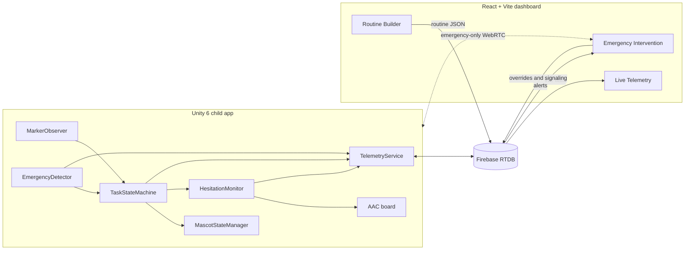
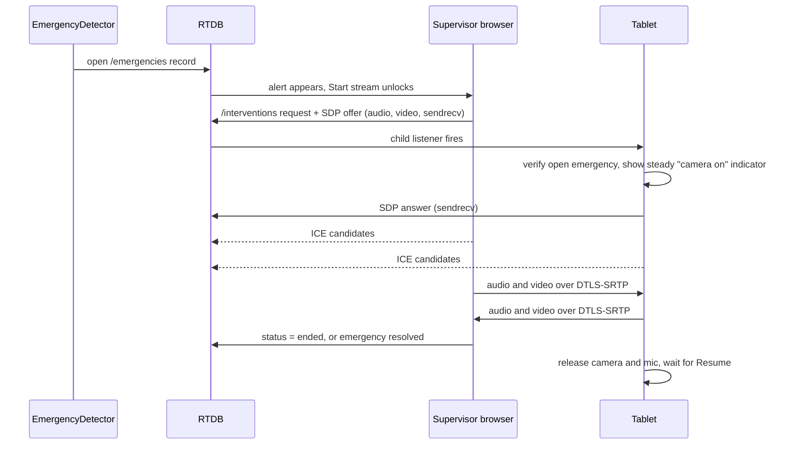
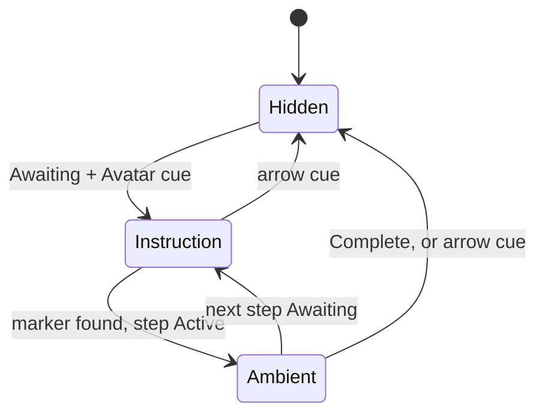
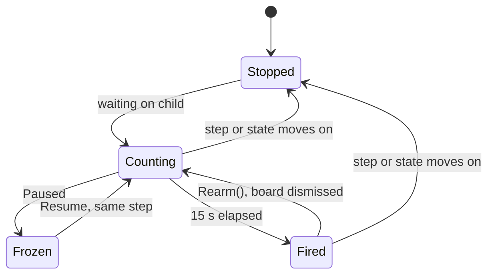
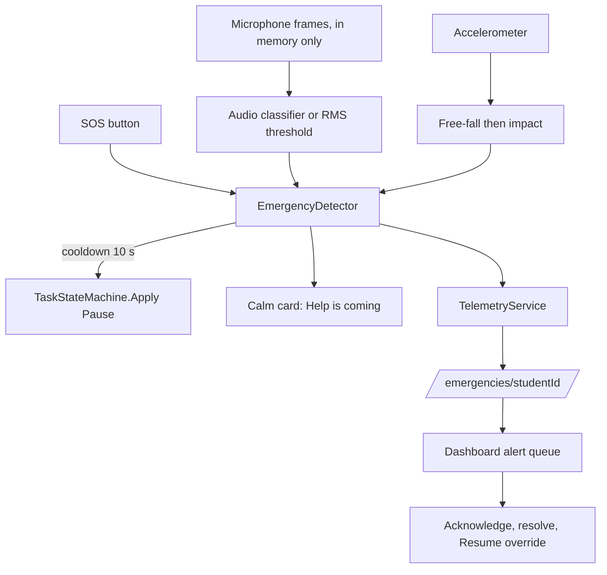

# Clinical Architecture: HLD and LLD (Phase 2)

Status: design for Phase 3 onward. Scope: Routine Builder, live intervention, mascot modes, hesitation support and emergency detection.

Existing docs still apply: `ARCHITECTURE.md` (modules), `DATABASE.md` (live schema), `SECURITY.md` (privacy), `DESIGN_SYSTEM.md` (low-sensory rules). Section 5 of this document is a **proposal**. Nothing in it is live until it goes through the `DATABASE.md` change protocol.

## 1. System overview



Invariants carried over from `AGENTS.md`:

- `TaskStateMachine` is the only writer of task state. New modules raise events or call its public API.
- Firebase is reached only through `TelemetryService` on Unity and `src/lib/services/` on the web.
- One instructional cue on screen at a time, and no flashing or looping attention motion. This also applies to alerts.
- Audio and camera frames leave the device only under the emergency streaming exception in `SECURITY.md`, and logs carry IDs only.

## 2. React and Vite supervisor dashboard

Routes: `/routines`, `/telemetry` (default), `/emergency`.

### 2.1 Component tree

```text
App (createBrowserRouter)
└─ AppLayout                      nav rail, <Outlet/>
   ├─ RoutineBuilderPage
   │  ├─ MarkerPalette            draggable cards, one per known Vuforia target
   │  ├─ RoutineCanvas            ordered drop list
   │  │  └─ StepCard              marker, cue, prompt, hold, AAC board
   │  ├─ StepInspector            edits the selected step
   │  └─ RoutinePayloadPanel      JSON preview, validation errors, Publish
   ├─ LiveTelemetryPage
   │  ├─ KpiTile (x4)             checkpoint, progress, autonomous %, avg time
   │  ├─ NodeHesitationTable      hesitation and wrong scans per checkpoint
   │  └─ ActivityLog
   └─ EmergencyInterventionPage
      ├─ AlertQueue               open alerts, source and age
      ├─ AlertDetail              acknowledge, resolve, resume
      └─ InterventionControl      start or end stream, video view, connection state
```

### 2.2 Routine Builder wireframe

```text
┌────────────┬───────────────────────────────┬───────────────────┐
│ Markers    │ Handwashing                   │ Step 2            │
│ [MK_SINK]  │  1 ▤ MK_SINK  Avatar          │ Prompt  [______]  │
│ [MK_SOAP]  │  2 ▤ MK_SOAP  Avatar  ◄ sel.  │ Cue     [Avatar]  │
│ [MK_RUB]   │  3 ▤ MK_RUB   Avatar   20 s   │ Hold    [0   ] s  │
│ [MK_TOWEL] │  4 ▤ MK_TOWEL Avatar    5 s   │ Board   [wash ]   │
│            │  ┄ drop a marker here ┄       │                   │
├────────────┴───────────────────────────────┴───────────────────┤
│ Payload preview, validation messages            [Publish]      │
└────────────────────────────────────────────────────────────────┘
```

Under 768 px the columns stack, and every drag has a Move up / Move down button so the builder works by keyboard and touch.

### 2.3 Routine payload

```json
{
  "name": "Handwashing",
  "kind": "adl",
  "version": 3,
  "checkpoints": {
    "cp_soap": {
      "order": 2,
      "markerId": "MK_SOAP",
      "label": "Soap",
      "cue": "avatar",
      "prompt": "Press the soap",
      "holdSeconds": 0,
      "aacBoardId": "board_wash"
    }
  }
}
```

Validation with zod in `src/lib/validation/`, before any write:

- `markerId` must be in the known marker catalog. Image Targets ship in the Vuforia database, so the builder cannot invent new ones.
- A marker appears at most once per routine, because the state machine needs one marker per transition.
- `prompt` is at most 6 words, and `order` values are contiguous from 1.
- Payload stays under 1 KB per checkpoint.

Two follow-ups this creates:

- **Rules:** `/routes` is admin-write today. Letting teachers publish needs a rule change.
- **Unity:** `TaskDefinition` is an authored ScriptableObject. Using published routines needs a runtime loader that builds a `TaskDefinition` from `/routes/{id}`, with the local asset as the offline fallback.

### 2.4 WebRTC live intervention

A guardian needs to see the physical environment during a meltdown to identify triggers, so the link is **two-way encrypted audio and video, allowed only during an active emergency**. The conditions are defined in the emergency streaming exception in `SECURITY.md`, and guardians agree to it in `GUARDIAN_CONSENT.md`.



- **Enforcement in three layers:** the dashboard unlocks the button only for an open emergency, database rules reject a request without one, and the tablet independently re-checks before capturing. The tablet check is the one that protects the child if the other two fail.
- **Detection never starts a stream.** It only unlocks one for a supervisor to start, so a false alarm cannot send video by itself.
- **Limits:** requests expire after 60 s, and a stream ends on resolve, on either side dropping, or after 15 minutes. Nothing is recorded, and the dashboard has no capture feature.
- **Signaling** uses RTDB. STUN is enough on simple networks, while school networks may need a TURN server, which is not provisioned yet.
- **Unity side:** `com.unity.webrtc`, sending the AR camera output. Its compatibility with Unity 6 and with Vuforia, which holds the device camera, is **unverified**, so spike it first. Streaming is also a heavy load for the >=30 FPS target, so drop AR rendering during a stream if needed.
- **Microphone:** `EmergencyDetector` audio monitoring stops while the stream holds the microphone. IMU and SOS stay on.
- **Sensory rule:** the tablet shows only the calm help card and the steady indicator, and incoming supervisor video is not shown to the child unless a supervisor enables it.

## 3. Unity 6 hybrid client

### 3.1 Dynamic mascot state machine

The mascot demonstrates a step at full quality, then steps back to a low-poly ambient form and voice while the child acts. This protects the >=30 FPS target and keeps attention on the real task.

| Machine state | Step cue | Mascot mode | Shown |
|---|---|---|---|
| `Awaiting` | Avatar | `Instruction` | Full 3D rig with demo clip |
| `Active` | Avatar | `Ambient` | Low-poly mascot, voice prompt |
| `Paused` | Avatar | `Ambient` | Low-poly mascot, no new prompts |
| any | Arrow or Arrived | `Hidden` | The arrow is the single cue |
| `Idle`, `Complete` | any | `Hidden` | Nothing |



- `MascotStateManager` reads state and never writes it. Mode resolution is one pure function, so it is unit-tested.
- Exactly one model is active. The final visual uses a 200 to 300 ms fade (opacity only, per `DESIGN_SYSTEM.md`); the boilerplate swaps instantly until art exists.
- `OnModeChanged` is the hook for the voice layer: speak the prompt once on entering `Ambient`, and never loop it.

### 3.2 Hesitation timer and AAC boards

**Hesitation** means the child should act and nothing has happened: the machine is `Awaiting`, or `Active` on a step with no hold still running. Time during a hold is not hesitation, since the child is doing the step.



Rules:

- Fires once per step until the board is dismissed, then a fresh 15 s starts. It never stacks or repeats on its own.
- A pause freezes the clock. A wrong scan does not reset it, because scanning the wrong marker is still not progress.
- Opening the board hides the instruction card, which keeps the one-cue rule. Dismissing restores it.

**Board content** comes from `aacBoardId` on the current step, so the symbols match the task: for the soap step, "soap", "show me again", "help", "break". Boards hold at most 4 symbols, icon plus text, with touch targets of at least 64 dp.

| Selection | Effect |
|---|---|
| Show me again | Mascot returns to its demo. No state change. |
| Help | `MarkAssisted()`, and a `help` request appears on the dashboard. |
| Break | `Apply(Pause)`. An adult resumes. |
| Object symbol, e.g. soap | Spoken aloud and logged. No state change. |

Opening a board does not by itself make a step non-autonomous, only a Help selection does. This is a clinical judgment call for the team to confirm with the supervising teacher.

### 3.3 Tripartite emergency detection



| Source | Trigger (starting values, need field calibration) | Dashboard severity |
|---|---|---|
| SOS button | Press | Confirmed |
| IMU | Below 0.3 g for 0.1 s, then above 2.5 g within 0.5 s | Likely |
| Audio | RMS above 0.6 for 0.5 s; later a classifier score | Suspected |
| Any two within 30 s | Same incident, escalated | Confirmed |

Design decisions:

- **Every source pauses the task.** A false pause costs one guardian tap, while a missed one leaves a distressed child being prompted.
- **Edge ML seam:** the boilerplate uses an RMS threshold. A sound classifier (for example a YAMNet-class model on Unity Inference Engine) can replace the RMS check without changing the event flow. No model is chosen yet. It should run about once per second off the main thread to protect the frame budget.
- **Microphone sharing:** Android's `SpeechRecognizer` and Unity's `Microphone` should be assumed not to share the mic. While guardian voice control is on, audio detection stops; IMU and SOS stay on.
- **Consent and permissions:** a Unity build using `Microphone` adds `RECORD_AUDIO`. `GUARDIAN_CONSENT.md` covers audio monitoring and streaming, and monitoring starts only after a guardian enables it.
- **Offline:** RTDB queues the alert until reconnection, so a supervisor may not see it. The tablet's calm card must therefore tell the child to stay and find an adult, and the card is local.
- **Limits:** this assists supervision and is not a medical or safety-certified system. It must never be the only safeguard.
- **Sensory rule:** alerts use `--help` with no blinking or sirens on the tablet. The dashboard may play a supervisor-only sound.

## 4. Module map (Phase 3 boilerplate)

| Script | Folder | Status |
|---|---|---|
| `MascotStateManager` | `Scripts/AR/` | Logic done; needs model references |
| `HesitationMonitor` | `Scripts/Core/` | Logic done; AAC UI not built |
| `EmergencyDetector` | `Scripts/Core/` | Thresholds and SOS done; telemetry and classifier not wired |

## 5. Firebase telemetry schema (proposed)

Existing paths stay as they are. The additions below extend them.

```text
/sessions/{studentId}/{sessionId}             add:
    activeDurationMs     total time excluding pauses
    hesitationTotalMs    sum over nodes
    wrongScanCount       sum over nodes

/nodeMetrics/{studentId}/{sessionId}/{pushId} append-only, one per step attempt
    { checkpointId, stepIndex, hesitationMs, holdMs, wrongScans,
      aacOpened, aacSelection?, outcome: "completed"|"skipped"|"reset",
      autonomous, timestamp }

/emergencies/{studentId}/{id}
    { sessionId, checkpointId, source: "audio"|"imu"|"sos", severity,
      status: "open"|"acknowledged"|"resolved", acknowledgedBy?, timestamp }

/interventions/{studentId}/{id}
    { emergencyId, requestedBy, status: "requested"|"connected"|"ended"|"expired",
      offer, answer?, candidates/{side}/{pushId}, startedAt, endedAt?, expiresAt }
```

Metric derivation:

| Metric | Source |
|---|---|
| Total session duration | `completedAt - startedAt` (wall clock), `activeDurationMs` (excludes pauses) |
| Hesitation time per node | `nodeMetrics.hesitationMs`, averaged by `checkpointId` |
| Wrong marker scans | `nodeMetrics.wrongScans`, counted from `OnUnexpectedMarker` |
| AAC use | Share of nodes with `aacOpened`, plus selection counts |

Rules to add:

- Default-deny stays. `nodeMetrics` is device append-only with `$other: false`, and supervisors read their own students.
- `emergencies`: the device creates, and an assigned supervisor can change only `status` and `acknowledgedBy`.
- `interventions`: an assigned supervisor creates, only if `emergencyId` points to an open emergency and the student has recorded streaming consent. The device writes only `answer`, its candidates and `status`.
- Indexes: `nodeMetrics/$studentId/$sessionId` on `timestamp`; `emergencies/$studentId` on `status`.
- Timestamps use the server. Durations are measured on the device from a monotonic clock, which is acceptable since they are spans and not points in time.
- Payloads stay under 1 KB. Node metrics write once per step, and emergencies write immediately, both within the 500 ms budget.

## 6. Open decisions

1. Decide how streaming behaves in private spaces, since handwashing may happen in or near a washroom. Until then every task is private by default, which means audio only (`TaskDefinition.privateSpace`).
2. Confirm with the supervising teacher that a Help selection, and not opening a board, is what ends "autonomous".
3. Choose an audio model, and calibrate all thresholds on the target tablet.
4. Decide who publishes routines: teachers (rule change) or admins only.
5. Test `com.unity.webrtc` 3.0.0 with Vuforia on the target tablet. Unity Editor loopback passes (`Phase4ValidationTests`), but no device test has run.
